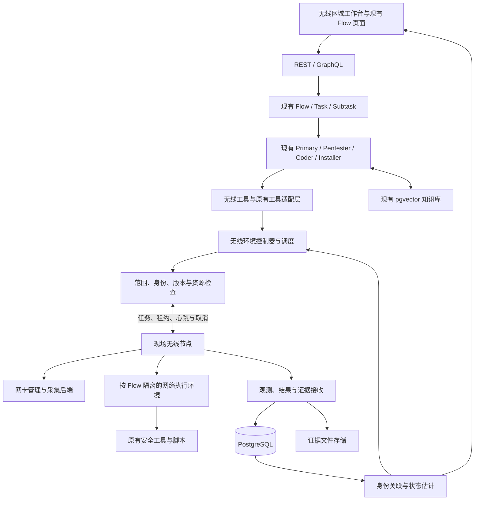
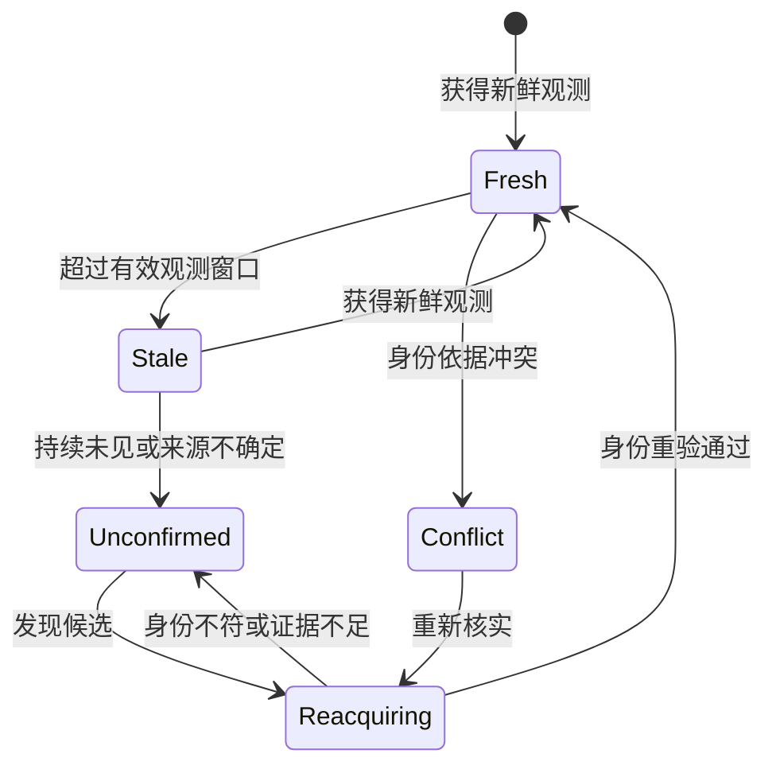
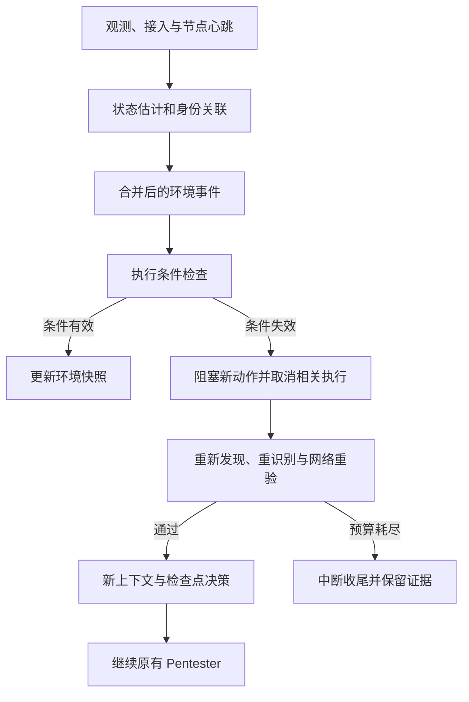

# PentAGI 区域无线网络渗透测试扩展设计

版本：0.2，设计稿，包含前端规划。

日期：2026-10-20。

本文根据项目源码分析与需求讨论重新整理，覆盖无线接入、原有网络与客户端渗透能力复用、动态环境控制、数据与接口、前端交互及实施验收。本文为待实现方案，不表示相关功能已经开发或通过运行验证。

## 1. 目标与关键决策

### 1.1 业务目标

对指定园区、楼宇或区域进行无线网络发现、接入与安全测试，在获得有效网络访问后，对范围内网络和客户端执行渗透测试，记录证据并支持整改复测。

无线热点可能关闭、移动、切换信道或重新出现；客户端可能休眠、漫游、离网或更换地址；节点也可能掉线。系统必须持续感知这些变化，并正确暂停、核对、重新验证和恢复任务。

### 1.2 核心决策

1. **复用原系统已有网络和客户端渗透能力。** 原有 Pentester、Coder、Installer、终端与脚本执行链继续承担实际测试，不重建整套客户端渗透引擎。
2. **新增无线环境适配。** 补齐现场节点、物理设备、采集、接入、身份关联和网络上下文。
3. **将动态变化纳入执行条件。** 目标身份、接入、地址和路由均有时效，不能把首次发现结果视为永久事实。
4. **前端沿用现有产品。** 新增无线区域工作台，扩展现有 Flow 工作区，继续使用原来的任务、终端、Agent、知识库和报告界面。
5. **明确事实、判断与证据。** 无线可见、接入成功、客户端可达和影响已验证分别记录。

### 1.3 首版范围

首版以园区或楼宇 Wi-Fi 为主，保留蓝牙、Zigbee 等协议扩展接口。每个无线 Flow 绑定一个有效接入上下文，可在其范围内顺序测试多个客户端。

| 能力 | 处理方式 |
| --- | --- |
| 通用网络、服务和客户端渗透执行 | 复用原有 Pentester 与工具环境 |
| 代码、工具安装、资料与经验检索 | 复用 Coder、Installer、Searcher、Memorist |
| Flow、Task、Subtask、日志与报告 | 复用并扩展环境状态 |
| 无线节点、网卡、采集与接入 | 新增 |
| 区域、观测、资产候选与身份重识别 | 新增 |
| 网络上下文版本、前置条件与失效控制 | 新增 |
| 节点任务账本、租约、取消与对账 | 新增 |
| 无线工作台、动态状态与覆盖展示 | 新增 |
| 全新客户端控制平台、通用多分支调度器 | 不作为首版前置条件 |

原系统有通用执行能力，不等于每一种客户端漏洞都可自动成功验证。实际测试仍取决于目标条件、网络可达性、工具环境和模型执行效果。

## 2. 总体架构



中心负责业务范围、资产视图、任务持久化、动态状态和 Agent 编排；现场节点负责物理设备、接入、实际执行和证据采集。

首版采用单中心调度进程和 PostgreSQL 持久化。节点主动建立认证连接，不假定现有进程内 Flow Worker 已具备完整的多副本调度能力。

## 3. 业务流程与测试能力

```text
定义区域、资产范围与测试配置
    → 检查节点、网卡和采集能力
    → 持续观测无线目标与覆盖质量
    → 核对资产归属和身份
    → 执行选定的无线接入测试
    → 建立有效网络上下文
    → 复用 Pentester 执行网络与客户端测试
    → 检查证据与成功条件
    → 清理、报告与整改复测
```

| 层次 | 内容 | 结果 |
| --- | --- | --- |
| 无线调查 | AP、SSID、BSSID、频段、信道、信号与变化 | 资产候选、覆盖和观测时间线 |
| 配置评估 | 认证、加密、PMF、WPS 信息与企业基线 | 配置问题及待验证发现 |
| 接入验证 | 指定测试项对应的认证和接入验证 | 接入结果及实际网络环境 |
| 网络内部测试 | 主机、服务、分段、访问控制与适用漏洞验证 | 可达资产、问题与测试路径 |
| 客户端测试 | 暴露服务、凭证辅助检查、配置和权限边界 | 具体客户端影响与证据 |

测试目录声明前置条件、影响等级、最长运行时间、成功证据和清理方法。影响业务的射频测试使用独立配置与执行窗口。

## 4. 现场节点与原有运行时适配

### 4.1 节点组成

| 组件 | 职责 |
| --- | --- |
| Node Agent | 注册、认证、心跳、任务账本和回传 |
| Radio Manager | 设备能力、租约、接口与信道状态 |
| Capture Adapter | 对接采集后端，输出规范观测与覆盖信息 |
| Access Manager | 管理接入并验证地址、路由和身份 |
| Execution Runtime | 为 Flow 提供隔离、可撤销的网络执行环境 |
| Process Supervisor | 登记、停止和核对任务及后台进程 |
| Local Spool | 有容量限制的离线缓存与补传 |

现场优先使用 Linux 节点，管理链路与测试链路分离。网卡和驱动的实际能力由探测确定；采集与接入并行优先使用独立网卡，同一物理设备的兼容运行需验证。

采集后端首版可适配 Kismet，采用独立服务接口。参考其 [Linux Wi-Fi 采集](https://www.kismetwireless.net/docs/readme/datasources/wifi-linux/)、[远程采集](https://www.kismetwireless.net/docs/readme/remotecap/remotecap/) 和 [信道调度](https://www.kismetwireless.net/docs/readme/datasources/channelhop/) 文档，实施时固定并验证具体版本。

### 4.2 网络出口与工具复用

无线接入由节点建立独立网络命名空间或等效隔离网关，Flow 渗透容器使用该上下文对应的网络出口。节点服务管理无线硬件，渗透容器不直接获得物理设备管理权限。

普通 Flow 沿用当前执行路径；无线 Flow 通过 Runtime Binding 选择现场运行时。现有 `NewFlowToolsExecutor()` 接收注入的 Docker 客户端，可作为适配位置，但共享客户端、容器生命周期和远程资源管理仍需改造。

适配必须覆盖容器创建、命令、文件传输、后台进程、停止和释放。Pentester、Installer、Coder、Assistant 以及脚本都经过同一上下文检查，防止只约束新增工具而留下原有终端旁路。

上下文失效时撤销相关网络出口并停止受影响进程。取消需要节点确认；已发生的外部影响保留证据，并按测试项执行必要清理。

## 5. 动态资产与观测

### 5.1 分离三类对象

| 对象 | 含义 |
| --- | --- |
| Asset | 有归属依据的逻辑资产 |
| Observation | 某节点在某时刻看到的无线或网络事实 |
| NetworkContext | 当前已经验证、带版本与有效期的执行条件 |

SSID、BSSID、IP 都是关联线索。不能仅凭同名 SSID、相同地址或相似信号强度确定是同一设备；无法重识别时保留候选关系。

观测至少包含：节点、节点启动标识、设备、来源序列号、观测与接收时间、时钟质量、区域点位、协议与信道、无线属性、覆盖窗口、候选身份依据和证据引用。

### 5.2 状态分开计算

- 目标观测：`fresh`、`stale`、`unconfirmed`、`reacquiring`、`retired`。
- 来源质量：`healthy`、`degraded`、`offline`、`coverage_gap`。
- 身份关联：`candidate`、`confirmed`、`conflict`。

未看到热点可能来自目标关闭、移动、信道变化、采集掉线、跳频遗漏或信号遮挡。判断必须结合来源健康、有效覆盖窗口和其他节点观测，不能直接等同于目标离线。



### 5.3 时序与覆盖

分别保存 `observed_at` 和 `received_at`。旧数据补传可以完善历史，但不能仅因刚到中心就恢复在线状态。节点启动标识和序列号用于去重与辅助排序；状态更新还需检查事件时间、来源和当前版本。

覆盖窗口记录实际信道、停留时间、节点状态、丢失或缓存异常、时钟质量与点位。缺失阈值按信道重访周期和环境配置调整，不写死通用离线秒数。

位置表达为观测区域、点位关联和置信度。信号变化可作为分析线索，不能单独证明精确坐标或移动轨迹。

## 6. 有期限的执行上下文

### 6.1 网络上下文与客户端绑定

```text
NetworkContext
├── context_id / flow_id / owner_user_id / tenant_scope
├── scope_id / policy_version / epoch
├── node_id / runtime_id / radio_lease_id
├── network_namespace_ref
├── access_asset_id / access_identity_revision
├── access_session_ref / credential_ref
├── local_addresses / gateway / dns / route_fingerprint
├── capabilities
└── last_verified_at / expires_at / state / reason
```

客户端另有 Endpoint Binding，记录逻辑资产、身份依据、当前地址与服务、`binding_revision`、最近验证时间和有效期。某客户端换地址只撤销对应绑定；接入本身仍有效时，不因此使整个 NetworkContext 过期。同一接入可以支持多个客户端的顺序测试。

凭证通过引用解析，不进入提示词和知识库。`capabilities` 表达当前已验证的访问或测试条件，不能由模型自行授予。

### 6.2 版本与有效期

`epoch` 是中心持久化分配的单调递增执行版本。接入重建、接入目标身份冲突、关键路由变化或节点切换使旧上下文被替代，旧版本任务不得继续启动。客户端变化使用独立绑定版本。

普通 RSSI 更新或不影响连接的信道变化不必每次增加 epoch。先判断变化是否影响实际执行条件，避免正常波动引发频繁重建。物理设备租约还具有独立版本和期限。

### 6.3 执行检查

中心排队前和节点实际执行前分别检查：

1. Flow 和任务仍允许执行。
2. 用户、范围、节点和策略版本匹配。
3. 上下文版本、有效期与资源租约满足要求。
4. 当前目标身份和地址绑定符合测试要求。
5. 接入、路由及服务可达性满足前置条件。
6. 操作类型、执行时间与预算仍可用。

运行期间持续监测关键条件，约束整个进程组及后台命令。中心无法瞬间撤销失联节点，因此节点必须执行本地租约期限和最长动作时间，用单调时钟计时。实际停止时延需要测量，不能承诺绝对即时停止。

## 7. 变化事件、暂停和恢复



高频观测在节点和中心聚合。模型只接收影响计划的摘要事件，不负责逐帧处理、网卡锁或超时判断。事件合并、去抖和重新发现预算防止任务反复启动、暂停。

| 变化 | 控制动作 | 恢复条件 |
| --- | --- | --- |
| 换信道且接入保持 | 更新采集安排 | 当前测试条件仍成立 |
| 目标暂时不可见 | 暂停依赖目标可见性的动作 | 有效观测与身份重验 |
| 接入断开 | 撤销依赖接入的上下文 | 接入、地址、路由和目标重验 |
| 其他节点发现相似目标 | 建立候选关联 | 身份、归属、范围与新节点重验 |
| 客户端换地址 | 撤销旧地址绑定 | 新地址与客户端身份重新绑定 |
| 节点失联 | 阻塞新任务，核对执行状态 | 节点账本与进程对账 |
| 身份冲突 | 阻塞相关测试 | 足够依据解决冲突 |
| 历史观测补传 | 补充历史 | 不直接恢复当前执行 |

首版保持 Task 内顺序执行。环境失效阻塞当前受影响执行链，不影响其他独立 Flow；不会自动把一个客户端的操作转向另一个客户端。复杂多分支调度后续再建设。

恢复按以下顺序进行：

1. 阻止旧版本继续执行，取消并获取节点确认。
2. 无法确认时先对账，保存中断原因、检查点和证据。
3. 在预算内重新发现并核对身份、归属与范围。
4. 重验接入、路由、客户端绑定和服务条件。
5. 下发新版本，确认节点接受。
6. 判断复用结果、重做检查或处理不确定副作用。
7. 更新 Agent 环境摘要，继续任务或由 Refiner 调整计划。

网络或节点切换后不承诺现有 TCP 连接、交互会话无缝迁移。新连接必须重新验证身份和权限。环境变化使用专门的上下文更新入口，不伪装成用户对 `ask` 的回复，也不编造工具返回。

## 8. 调度、幂等、取消与重试

### 8.1 操作状态与账本

```text
queued → leased → running → succeeded / failed / inconclusive
                    ↓
              cancel_requested → cancelled
                    ↓
                reconciling
```

`reconciling` 表示执行结果未知，必须核对节点账本和进程。环境等待通过绑定状态及 `blocked_environment` 原因表达，前端与等待用户输入分开显示。

任务持久化以下字段：

```text
job_id / logical_operation_id / idempotency_key
flow_id / task_id / subtask_id / plan_revision
scope_id / policy_version
context_id / expected_epoch / lease_generation
target_asset_id / target_binding_id / expected_binding_revision
operation_type / parameters_hash
node_id / expires_at / max_runtime
state / process_ref / evidence_refs
```

节点在接受和启动时写入持久化账本，并登记进程。重复幂等键返回已有状态，不再次执行。幂等键不能只依赖可能被 Refiner 替换的 Subtask ID。

计划变更撤销被替换步骤尚未启动的操作，节点同时检查计划版本；证据与历史执行不能随计划替换级联删除。新上下文版本也不能绕过旧操作状态未知的问题。

节点在动作启动后、结果回传前崩溃时，通过账本、进程和证据对账；无法确认则保留不确定状态，不宣称严格的一次执行语义。

### 8.2 错误分类

| 分类 | 处理 |
| --- | --- |
| 参数错误 | 校验，必要时有限修复 |
| 尚未接受任务的短暂传输失败 | 在幂等约束下重试 |
| 环境过期、目标不可确认 | 阻塞并交给环境控制器 |
| 身份或范围冲突 | 阻塞，重新核实 |
| 已接受任务但响应丢失 | 对账，禁止盲目重放 |
| 检查已产生问题或证据不足结果 | 保存业务结果，不按参数错误处理 |

现有 `ContextToolsExecutor.Execute()` 的错误可能触发调用方重试，因此要在 `performer.go` 中分流环境状态，不能把所有失联交给 `tool_call_fixer`。节点检查须独立于模型判断持续生效。

### 8.3 取消与预算

取消包括中心撤销版本或租约、通知节点、终止进程组、确认状态、释放资源和回传证据。未确认时保持对账，防止旧任务与新任务重叠。预算覆盖动作时长、重新发现时间、接入尝试、重识别次数、整体任务时间和模型成本。

## 9. 数据与接口

### 9.1 数据对象

| 对象 | 职责 |
| --- | --- |
| Site / Zone / Point | 区域层级、平面图和采集点位 |
| Scope | 资产归属、允许操作、时间与策略版本 |
| Node / Radio / RadioLease | 能力、健康、物理设备与占用 |
| Asset / IdentityLink | 逻辑资产和候选身份依据 |
| Survey / CoverageWindow / Observation | 调查、有效覆盖与时序事实 |
| NetworkContext / EndpointBinding | 网络与客户端的有效版本 |
| FlowBinding / Job | Flow 场景、执行绑定和幂等账本 |
| Event / Outbox | 事件去重与可靠派发 |
| Finding / Evidence | 问题、判定、证据和复测 |

建议以 `wireless_` 前缀新增表，遵循现有部署 schema 隔离机制，显式保留业务用户与范围归属。上下文撤销、版本更新、绑定和 outbox 在同一事务内提交；任务领取使用行锁或比较更新。

观测按资产、节点、时间查询建立索引。高频帧先聚合，原始数据按需进入证据文件存储；达到数据量阈值后对观测按时间分区。事件按节点、启动标识和序列号去重。

### 9.2 Agent 工具

| 拟新增工具 | 用途 |
| --- | --- |
| `wireless_nodes_list` | 查询节点、能力与资源 |
| `wireless_survey_start` | 启动范围内调查，返回 job_id |
| `wireless_assets_query` | 获取资产候选、新鲜度和身份依据 |
| `wireless_access_test` | 指定测试项、目标和凭证引用的接入验证 |
| `network_context_get` | 获取当前版本、期限和可用能力 |
| `wireless_job_status` | 查询状态、覆盖质量和结果 |
| `wireless_job_cancel` | 取消或进入执行状态核对 |
| `wireless_evidence_get` | 获取有权限的证据摘要 |

原有网络和客户端操作仍通过 Pentester、终端与脚本完成，由运行时统一约束上下文。需要结构化复测的检查项按需增加插件。

### 9.3 API 草案

```text
POST /api/v1/wireless/scopes
GET  /api/v1/wireless/nodes
POST /api/v1/wireless/surveys
GET  /api/v1/wireless/assets
POST /api/v1/wireless/flows
GET  /api/v1/wireless/contexts/{id}
GET  /api/v1/wireless/jobs/{id}
POST /api/v1/wireless/jobs/{id}/cancel
GET  /api/v1/wireless/findings
GET  /api/v1/wireless/evidence/{id}
```

上述接口均为拟新增。长操作返回 job_id；资产、任务和环境变化通过 GraphQL 订阅推送。接口有分页、时间范围和字段上限，节点通过认证连接领取任务并回传结果。

## 10. 前端规划

### 10.1 导航与页面

主导航新增“无线评估”，保留现有 Dashboard、Flows、Templates、Resources、Knowledges 和 Settings。无线任务仍是 Flow，继续出现在现有任务列表、最近任务和收藏中，增加无线场景标识。

| 页面 | 拟定路由 | 职责 |
| --- | --- | --- |
| 无线总览 | `/wireless` | 区域、调查、节点和任务汇总 |
| 区域工作台 | `/wireless/areas/:areaId` | 热点、客户端、覆盖和环境事件 |
| 节点管理 | `/wireless/nodes` | 点位、能力、健康和占用 |
| Flow 工作区 | 沿用 `/flows/:flowId` | Agent、终端、任务和无线环境 |
| Flow 报告 | 沿用现有报告路由 | 测试路径、证据、中断和复测 |

资产详情首版使用侧边抽屉，选择状态写入 URL，支持刷新和分享。路由使用稳定资产 ID，不用 SSID 或 IP 作为主标识。

### 10.2 无线总览

总览以区域为入口，展示可用节点、当前观测热点、待确认资产、执行中任务、等待环境任务和已验证发现。指标注明统计时间范围及数据更新时间。

空状态区分未配置节点、节点离线、尚未开始调查、覆盖不足和有效调查后未见目标。接口不可用或未启用功能时说明原因，不填充假数据或显示“全部安全”。

### 10.3 区域工作台

```text
┌────────────────────────────────────────────────────────────┐
│ 无线评估 / 园区 / 楼层                 开始调查  创建任务   │
├────────────────────────────────────────────────────────────┤
│ 可用节点   当前观测热点   待确认资产   等待环境任务          │
├────────────────────────────────────┬───────────────────────┤
│ 热点 / 客户端 / 覆盖 / 事件          │ 选中资产              │
│ 搜索、筛选、列表或平面图             │ 身份与归属            │
│                                    │ 最近观测及来源        │
│ 资产列表                           │ 接入与可达性          │
│ 名称、状态、归属、最后确认、关联任务 │ 关联任务、发现和证据  │
│                                    │ 当前可执行操作        │
└────────────────────────────────────┴───────────────────────┘
```

热点列表包括 SSID、BSSID、归属、频段、信道、最近信号、最后观测时间、来源节点和关联任务。客户端列表包括身份依据、当前地址、所属网络、最近可达时间、服务与测试结果；推测属性注明置信程度。

暂时消失的资产保留行、选中状态和历史结果，状态降为过期或待确认。新观测更新同一资产或候选关联，不自动移除旧行，也不自动切换用户选中的目标。列表更新保留滚动位置，新增资产以计数提示或显式刷新排序呈现，避免持续跳行。

平面图辅助展示节点点位、观测区域和有效覆盖；无可靠定位依据时不绘制热点精确坐标。首版以可用的列表与覆盖信息优先，复杂热力图后续增强。

### 10.4 扩展现有 Flow 工作区

现有桌面 Flow 中央为 Automation、Assistant、Dashboard，侧面包含 Terminal、Tasks、Agents、Searches、Vector Store、Files 和 Screenshots；移动端通过标签切换。

无线 Flow 增加以下内容：

- 顶部环境摘要：区域、接入目标、执行节点、接入状态、最后确认时间。
- 中央“无线环境”标签：目标身份、接入、网络、客户端绑定和覆盖质量。
- 环境事件时间线：观测失效、接入中断、重识别、重验和恢复。
- 任务关联：当前步骤依赖哪个热点或客户端，以及阻塞原因。
- 报告补充：测试时的环境、覆盖缺口、历史发现与当前复测状态。

普通 Flow 沿用原布局。无线标签按场景启用并延迟加载，不能让普通 Flow 的 URL 标签和默认切换行为退化。移动端同样可访问无线环境，以抽屉和单列视图替代挤压的多面板。

### 10.5 状态表达

界面分别呈现观测、身份、接入和执行四个维度：

| 维度 | 用户可见状态 |
| --- | --- |
| 观测 | 近期观测、观测过期、暂时无法确认 |
| 身份 | 已确认、候选关联、存在冲突 |
| 接入 | 未接入、验证中、可用、已中断 |
| 执行 | 执行中、等待环境、取消中、核对状态、已完成 |

用文字和图标表达，颜色作为辅助。默认展示业务状态，epoch、租约版本等技术字段仅在诊断详情中提供。

环境变化提示应说明原因和系统下一动作，例如：“接入已中断，客户端测试已暂停；正在重新发现目标，恢复前将重新验证身份和网络条件。”

节点或前端订阅断开时显示数据可能过期，不能自行推断热点已离线。执行结果未知时显示核对状态，不能提供会立即重放动作的普通重试按钮。

### 10.6 新建无线 Flow

在现有创建入口增加任务场景“常规测试 / 无线网络测试”，保留模型、模板、任务描述和资源选择。无线场景补充：

1. 范围：区域、热点或客户端、测试配置。
2. 执行环境：节点、所需能力和资源可用情况。
3. 接入方式：已有接入或指定接入测试、凭证引用。
4. 恢复策略：自动重验恢复、重新发现预算和整体时限。

区域页选中资产后可带入创建表单，提交前向服务端预检查新鲜度、身份、节点与资源。提交失败保留用户输入；后台目标变化不能静默替换表单目标。

### 10.7 操作语义

| 操作 | 含义 |
| --- | --- |
| 停止调查 | 停止本次采集 |
| 停止当前测试 | 停止执行，保留 Flow 和结果 |
| 重新发现 | 更新目标观测 |
| 重验并继续 | 确认环境后恢复任务 |
| 结束 Flow | 结束工作空间并释放资源 |

停止请求后显示“停止中”，收到节点确认后才显示已停止；失联则保留待核对。按钮根据服务端返回的允许操作和原因启用，界面禁用不是后端执行检查的替代。

创建操作返回 job_id 后，刷新或网络中断先查询该操作状态，不能因为页面未收到成功响应就自动重复提交。

### 10.8 实时数据与缓存

沿用 Apollo 和 GraphQL，新增按页面加载的无线领域 Provider：区域、资产、节点和 Flow 环境。避免全站挂载高频订阅。

数据链路先取快照，再订阅后续变化；服务端需提供快照版本或游标及补齐方式。断线重连时重放缺失事件或获取新快照，防止查询和订阅之间出现空档。

按服务端版本合并，旧事件不得覆盖新状态；不同区域、范围和历史时间的查询分别缓存。历史回放与实时视图有明确模式和“返回实时”入口，历史状态不能触发主动测试。

高频观测合并批量更新，分页或虚拟化展示大列表。保持已选资产与当前视口，避免每次信号更新都对整张表重排。页面可更新“距上次确认多久”，但不能仅凭浏览器计时宣布目标离线。

### 10.9 前端代码规划

```text
frontend/src/pages/wireless/
    wireless-overview.tsx
    wireless-area.tsx
    wireless-nodes.tsx
frontend/src/features/wireless/
    assets/          热点、客户端和详情抽屉
    coverage/        点位、平面图和覆盖信息
    nodes/           节点能力、健康和占用
    flows/           创建表单扩展和 Flow 环境面板
    events/          环境变化时间线
    findings/        问题、证据和复测展示
frontend/src/providers/
    wireless-area-provider.tsx
    wireless-assets-provider.tsx
    wireless-nodes-provider.tsx
    wireless-flow-provider.tsx
```

在 `app.tsx` 和 `lib/routes.ts` 注册页面，在主导航增加入口，更新 Flow 的中央、移动端标签与对应 URL 检测。表格、抽屉、表单和详情导航沿用现有组件，业务耦合留在 `features/wireless`，不放入通用 UI 组件。

遵循仓库 [列表与详情页规范](frontend/docs/list-detail-pages.md)，前后端 Schema 变更后重新生成 GraphQL 类型。

## 11. 验证、证据、报告与知识

### 11.1 测试结果

| 结果 | 含义 |
| --- | --- |
| pass | 在记录的条件和时间内通过检查 |
| finding | 问题与证据满足对应判定规则 |
| inconclusive | 目标变化、覆盖不足或证据不足 |
| not_run | 前置条件或策略不允许启动 |
| execution_error | 工具或基础设施未完成检查 |

工具进程返回、模型提交成功和业务目标验证分别记录。关键发现由固定检查器核对证据，模型负责解释和关联，不只依赖 `done.success` 或报告中的自然语言判断。

### 11.2 证据与报告

每条发现绑定资产身份、执行节点、时间、工具与规则版本、上下文版本、客户端绑定和证据引用。证据保存摘要校验、采集来源和访问范围。

报告包含区域与覆盖、接入环境、网络与客户端测试路径、已验证问题、未验证环节、中断与恢复、清理状态和整改复测。历史事实与当前状态分开，不能因目标消失就删除发现，也不能未经复测认定风险持续存在或已经消失。

### 11.3 知识与技能积累

复用现有 `guide/code/answer` 存储脱敏方法、脚本和技术答案，附带适用条件、来源、版本与验证记录。原始抓包、临时地址、凭证和现场事实进入独立事实或证据存储。

知识检索辅助模型决策，现场身份、可达性和接入条件仍需实时验证。候选经验经过可重复测试后再作为优先复用技能，失败经验记录原因和停止条件。

## 12. 范围与数据边界

测试范围绑定归属资产、允许操作、时间和预算。地图区域表达调查位置，被动接收到邻近信号不会自动扩大主动测试范围。中心与节点分别核对目标和操作绑定。

采集优先保留评估所需元数据，原始证据按需、限额保存，设置保留期并控制访问。凭证使用引用，日志与知识入库脱敏。无线名称、扫描输出和抓包内容均作为不可信数据，不能改变工具权限与执行策略。

## 13. 与现有源码集成

| 位置 | 拟改造内容 |
| --- | --- |
| `pkg/controller/flows.go` | 无线场景与 Runtime Binding，普通 Flow 沿用原路径 |
| `pkg/controller/flow.go` | 恢复前环境核对、停止时节点取消与确认 |
| `pkg/controller/context.go` | 加入动态运行时绑定引用 |
| `pkg/controller/task.go`、`subtask.go` | 区分环境等待、用户等待和状态未知 |
| `pkg/providers/performer.go` | 环境错误分流，约束不适当重试 |
| `pkg/providers/helpers.go` | 新鲜环境摘要与历史事实失效信息 |
| `pkg/tools/tools.go`、`terminal.go` | 原有工具选择现场运行时并统一检查绑定 |
| `pkg/tools/registry.go` | 无线工具定义与参数 Schema |
| `pkg/docker/` | 按 Flow 选择运行时、网络出口与资源收尾 |
| `pkg/graph/`、`pkg/server/` | API、权限和实时事件 |
| `migrations/`、`sqlc/` | 数据表、事务、版本与租约查询 |
| `frontend/src/` | 无线工作台、Flow 扩展和领域订阅 |

拟新增后端模块：

```text
backend/cmd/wireless-node/       现场节点入口
backend/pkg/wireless/           区域、观测、身份和状态
backend/pkg/wireless/runtime/   执行绑定、版本与恢复
backend/pkg/wireless/node/      协议、租约和账本
backend/pkg/tools/wireless/     无线工具 Handler
```

首版保留原 Agent 类型枚举，通过场景提示词与 Executor 扩展。环境恢复需要新增明确入口，不能只修改提示词或重放原始用户输入。

## 14. 实施计划

| 阶段 | 后端与节点 | 前端 | 验收重点 |
| --- | --- | --- | --- |
| P0：纵向打通 | 单节点、指定接入、绑定网络出口、原有 Pentester 测试指定客户端 | 新建无线 Flow、基础环境摘要 | 原有能力可复用，路由正确，旧版本可阻断 |
| P1：区域调查 | 多点观测、资产候选、覆盖质量 | 无线入口、区域列表、节点页与抽屉 | 身份冲突、覆盖不足和历史补传表达正确 |
| P2：动态闭环 | 租约、取消、对账、重识别与检查点恢复 | 等待环境、恢复时间线、订阅补齐 | 未知状态不重放，恢复前完成重验 |
| P3：评估复测 | 基线、证据判定、复测和经验提炼 | 发现、证据、报告与历史对比 | 结果可追溯、可复测，历史与当前分开 |

P0 必须包含基础版本检查和失效阻断，不能等到后期才补齐。复杂平面图、热力图和多分支并发按实际需求迭代。

## 15. 验收与测试

### 15.1 必测场景

| 场景 | 预期结果 |
| --- | --- |
| 热点关闭后重现 | 暂停依赖任务，身份与网络重验后继续 |
| 同名 SSID 对应不同设备 | 不自动识别为原目标 |
| 目标跨节点重现 | 新节点核实范围并建立新上下文 |
| 换信道但接入保持 | 调整采集，不无条件重启流程 |
| 旧 IP 被其他客户端使用 | 拒绝沿旧地址继续测试 |
| 采集节点失联 | 来源异常，不直接判断所有热点关闭 |
| 补传旧观测 | 只更新历史，不错误恢复当前状态 |
| 任务接受后回执丢失 | 查询账本，不重复执行 |
| 旧版本操作延迟到达 | 节点拒绝启动 |
| 运行期间上下文撤销 | 阻断后续动作，按本地期限收尾并回报 |
| 中心重启或 Flow 恢复 | 先核对环境和节点，再恢复 Agent |
| Assistant 或后台命令运行 | 经过与 Pentester 相同的环境检查 |
| 多任务争用网卡 | 租约串行或明确兼容，不互相抢占 |
| 重新发现预算耗尽 | 中断或证据不足收尾，保留历史证据 |
| 普通 Flow | 原流程和布局无回归 |

### 15.2 前端专项验收

- 目标暂时消失时保留行、详情和选中状态。
- 同名热点和客户端换 IP 后不错误关联任务。
- 停止中、已停止和执行状态未知严格区分。
- 断线重连能补齐快照或事件，旧版本不能覆盖新状态。
- 历史回放不污染实时状态，也不提供主动测试操作。
- 高频更新保持排序、视口和输入稳定。
- 无节点、节点异常、覆盖不足、无目标等空状态明确。
- 桌面与移动端均能访问无线环境，旧 Flow 深链接正常。
- 无权限操作和环境前置条件失败有明确说明。

### 15.3 验证方式与指标

先通过录制观测回放和模拟节点验证事件乱序、重复、迟到、版本和取消，再在可控无线环境验证物理设备、接入与客户端变化。前端使用现有 Vitest、Playwright 测试层补充动态场景；后端按涉及包和依赖层运行相应测试。

测量有效覆盖、身份误关联、环境失效检测时间、取消确认时延、旧版本拒绝率、对账收敛时间、恢复成功率、证据完整性和模型成本。性能门槛在实测建立基线后固定。

旧版本任务不得启动、错误身份不得自动续行、状态未知不得盲目重放属于功能要求。

## 16. 实施前需固定的参数

- 首批区域、点位、节点数量、频段、网卡与驱动。
- 采集与接入并行方式及管理链路。
- 首批网络和客户端测试项、成功证据与清理方式。
- 资产归属与重识别可使用的外部依据。
- 覆盖窗口、心跳、租约、重新发现和整体任务预算。
- 证据存储、访问范围、保留期和容量限制。
- 现场运行时与现有 Docker 生命周期的具体适配。

这些参数通过配置和范围对象固定，模型可以建议计划，不能自行放宽执行约束。

## 17. 源码索引

| 文件 | 阅读重点 |
| --- | --- |
| [backend/pkg/tools/tools.go](backend/pkg/tools/tools.go) | Pentester 原有能力、Executor 与客户端注入 |
| [backend/pkg/tools/terminal.go](backend/pkg/tools/terminal.go) | 命令、文件、后台执行和错误 |
| [backend/pkg/providers/performer.go](backend/pkg/providers/performer.go) | 调用循环、重试与错误分流 |
| [backend/pkg/providers/helpers.go](backend/pkg/providers/helpers.go) | 消息恢复和环境摘要 |
| [backend/pkg/controller/flows.go](backend/pkg/controller/flows.go) | Flow 创建、注册与恢复 |
| [backend/pkg/controller/flow.go](backend/pkg/controller/flow.go) | 恢复后执行、停止、命令清理和释放 |
| [backend/pkg/controller/context.go](backend/pkg/controller/context.go) | 共享上下文 |
| [backend/pkg/controller/task.go](backend/pkg/controller/task.go) | 顺序执行和动态规划 |
| [backend/pkg/controller/subtasks.go](backend/pkg/controller/subtasks.go) | 计划替换与子任务 ID 变化 |
| [backend/pkg/providers/assistant.go](backend/pkg/providers/assistant.go) | Assistant 干预入口 |
| [examples/guides/worker_node/README.md](examples/guides/worker_node/README.md) | 当前 Worker Node 的 Docker 沙箱范围 |
| [frontend/src/app.tsx](frontend/src/app.tsx) | 应用路由和 Provider |
| [frontend/src/lib/routes.ts](frontend/src/lib/routes.ts) | 统一路由生成 |
| [frontend/src/components/layouts/main/main-sidebar.tsx](frontend/src/components/layouts/main/main-sidebar.tsx) | 主导航和最近任务 |
| [frontend/src/pages/flows/flow.tsx](frontend/src/pages/flows/flow.tsx) | Flow 页面与布局 |
| [frontend/src/features/flows/flow-central-tabs.tsx](frontend/src/features/flows/flow-central-tabs.tsx) | 桌面中央标签 |
| [frontend/src/features/flows/flow-tabs.tsx](frontend/src/features/flows/flow-tabs.tsx) | 侧面和移动端标签 |
| [frontend/src/hooks/use-flow-tab-detection.ts](frontend/src/hooks/use-flow-tab-detection.ts) | 标签与 URL 状态 |
| [frontend/src/providers/flow-provider.tsx](frontend/src/providers/flow-provider.tsx) | Flow 数据、订阅与追赶 |
| [frontend/src/lib/apollo.ts](frontend/src/lib/apollo.ts) | 缓存、订阅与流式内容 |
| [frontend/docs/list-detail-pages.md](frontend/docs/list-detail-pages.md) | 列表和详情页复用规范 |

本次交付仅重新输出设计文档，未进行无线采集、网络接入、客户端测试、硬件验证或功能实现。
